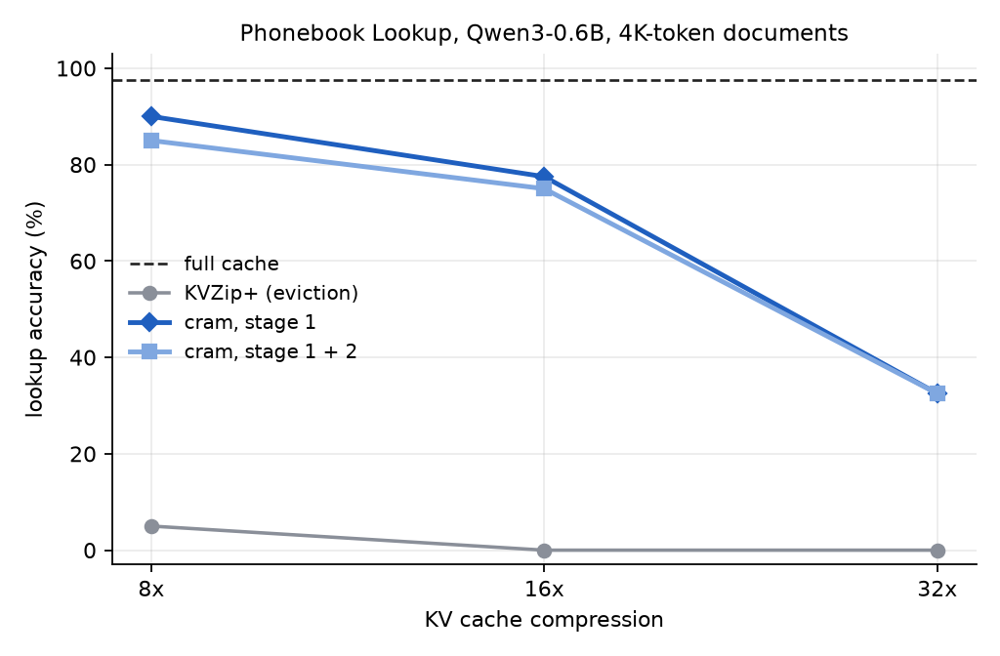

<h1 align="center">cram</h1>

<p align="center">
  <a href="https://github.com/tatra-labs/cram/actions/workflows/tests.yml"></a>
  <a href="https://arxiv.org/abs/2610.20582"></a>
  <a href="LICENSE"></a>
</p>

<p align="center"><b>Cram a long document into a tiny KV cache.</b><br>
Before any question arrives, the model studies the document and trains a KV cache many times smaller
than the original, then answers questions from it.</p>

<p align="center">
  <a href="https://arxiv.org/abs/2610.20582">Paper</a> ·
  <a href="#quickstart">Quickstart</a> ·
  <a href="#how-it-works">How it works</a> ·
  <a href="#results">Results</a>
</p>



A long document's KV cache is the main cost of long-context inference: memory, bandwidth, batch
size. Eviction methods keep a subset of the cached entries and drop the rest, which breaks down under
aggressive compression: drop the entry that held a phone number and the number is gone.

[*Latent Compaction with Test-Time Training*](https://arxiv.org/abs/2610.20582) (Chen et al.,
Tsinghua, October 2026) treats the cache as a small neural network instead, and **trains it**.
Model weights stay frozen. Each document gets its own compact set of key/value slots, optimized by
gradient descent to make the frozen model behave as if it still had the full cache. On RULER the
paper reaches 96.7% accuracy at 32× compression, against 40.0% for the strongest eviction baseline
(KVZip+).

**cram** is a compact, hackable implementation for Hugging Face models in about 600 lines. It plugs
into the standard attention interface of `transformers`, so it works with Qwen3, Llama and other
modern decoders without touching their code.

## Quickstart

```bash
git clone https://github.com/tatra-labs/cram && cd cram
pip install -e ".[examples]"

cram compact report.txt --ratio 16          # study once: writes report.txt.cram
cram ask report.txt.cram "Who signed the agreement?"
```

Or from Python:

```python
import torch, cram
from transformers import AutoModelForCausalLM, AutoTokenizer

tok = AutoTokenizer.from_pretrained("Qwen/Qwen3-0.6B")
model = AutoModelForCausalLM.from_pretrained("Qwen/Qwen3-0.6B", dtype=torch.bfloat16).cuda()

document = open("long_report.txt").read()
cache = cram.compact(model, tok, document, cram.Config(ratio=16))   # minutes, once per document
cache.save("long_report.cram")                                      # reuse it for every question

print(cram.generate(model, tok, cache, "\n\nQuestion: Who signed the agreement?\nAnswer:"))
cache = cram.CompactCache.load("long_report.cram", device="cuda")   # later, without the document
```

Reproduce the benchmark below:

```bash
python examples/phonebook.py --model Qwen/Qwen3-0.6B --tokens 4096 --ratios 8 16 32 --docs 2
```

## How it works

For each layer and KV head, the compact cache holds *n* slots, each a key, a value and a scalar
bias. A query attends to the slots (with their biases) and to the question's own tokens, merged
through their log-normalizers into exactly one softmax. Questions are positioned after the original
document, so nothing about the model changes.

1. **Study.** The frozen model reads the document once (the full cache), then answers 480 generic
   prompts about it (*"Summarize the document's main subject and structure. Answer briefly."*), from
   independent forks of the full cache. These rollouts provide teacher queries and next-token
   distributions. No evaluation question is ever used.
2. **Initialize.** Three quarters of the budget are *preservers*: the original entries with the
   highest KVZip+ reconstruction scores, ranked globally across all layers and heads, so heads that
   matter get more slots. The rest are *anchors* (the first entry plus the most-attended entries) and
   *diversifiers* (farthest-first in key space, for coverage).
3. **Stage 1: attention fitting.** Layer by layer, anchors and diversifiers are trained so that
   attention over the compact cache reproduces the full cache's attention outputs **and**
   log-normalizers on the teacher's queries. Preservers stay frozen.
4. **Stage 2: end-to-end distillation.** All slots are trained together so the model's next-token
   distributions on the rollouts match the full-cache model's (top-20 KL plus tail mass, plus
   cross-entropy on the teacher's greedy tokens). Unlike the paper, which trains for a fixed 1,000
   updates, cram holds out 10% of the generic rollouts and keeps the checkpoint with the lowest
   held-out loss, starting from the stage-1 cache itself, so stage 2 never makes the held-out fit
   worse. With a smaller prompt bank (160 prompts), a fixed schedule overfit and cost up to 15 points.

The log-normalizer is what makes this work: it tells the model how much attention the whole document
should get relative to the question, which is what a compressed cache otherwise gets wrong. In the
paper's ablation, dropping it from stage 1 lowers Phonebook accuracy at 16× compression from 80.7% to
36.5%.

## Results

Phonebook Lookup with [Qwen3-0.6B](https://huggingface.co/Qwen/Qwen3-0.6B): each document is 4,096 tokens
of 180 *"The phone number of NAME is NUMBER."* lines. Each method compresses the document before seeing any
question, then answers 20 lookups (greedy decoding); 2 documents, one laptop RTX 5060.

| lookup accuracy | 8× smaller cache | 16× | 32× |
|---|---:|---:|---:|
| full cache (reference) | 97.5% | 97.5% | 97.5% |
| KVZip+ eviction, the strongest baseline in the paper | 5.0% | 0.0% | 0.0% |
| **cram, stage 1** | **90.0%** | **77.5%** | **32.5%** |
| cram, stage 1 + 2 | 85.0% | 75.0% | 32.5% |

Eviction keeps a fixed subset of the original entries, and at 8× it has already lost almost every number.
Trained slots keep most of them. Studying a document took about 9 minutes (480 teacher rollouts); stage 1
then took about 2 minutes per budget and stage 2 another 4 to 8.

For this small model, stage 1 does the work. Stage 2 kept lowering the distillation loss on held-out generic
prompts but did not improve lookups: −5, −2.5 and 0 points, that is, one question or less per document. The
paper reports stage 2 gains with Qwen3-1.7B; `Config(stage2_steps=0)` skips it.

Reproduce with `python examples/phonebook.py` (about an hour on a laptop GPU); raw numbers are in
[`results/`](results).

## Notes

- The budget is counted in logical KV pairs, as in the paper: a 16× cache stores 1/16 of the
  document's key/value pairs, plus one bias per slot. Question and answer tokens are not counted.
- Studying a document takes minutes, not milliseconds. It pays off when the same document answers
  many questions, or must sit in memory for a long time.
- The compact-cache attention is plain PyTorch, so compressed caches currently save memory, not time.
  A fused kernel that also returns log-normalizers would make them fast.
- Batch size 1; the code is written for clarity over throughput.

## Citation

An independent implementation; all credit for the method goes to the authors.

```bibtex
@article{chen2026latent,
  title   = {Latent Compaction with Test-Time Training},
  author  = {Chen, Yingfa and Shen, Xingyu and Xiao, Chaojun and Han, Xu},
  journal = {arXiv preprint arXiv:2610.20582},
  year    = {2026}
}
```

MIT License.
